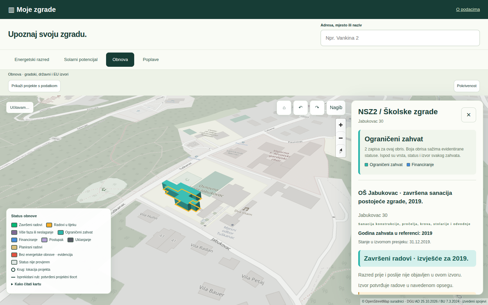

# Moje zgrade — završna javna verzija v203

https://moje-zgrade-delta.vercel.app/

Neovisni Vercel runtime iz zamrznutog predajnog presjeka final-handover-20261107-v203. Nema proxyja ni poziva prema Bartolu. Hosting ostaje Vercel Hobby s većom funkcijom uključenom postojećom beta postavkom.

Obuhvat: Zagreb, 129.365 kanonskih obrisa i 7.898 projektnih/događajnih zapisa obnove. To nije broj jedinstvenih obnovljenih zgrada. 41 zapis nema potvrđenu lokaciju. Solar razlikuje izvorni gradski model i označene procjene; poplavno stanje nije jamstvo odsutnosti rizika.

## Ponovljiva objava

build.mjs preuzima javni runtime iz nepromjenjivog GitHub izdanja final-v203-20261107 i provjerava SHA256 62ecc489038588993c3854fbb22fd1a5c26b171cbef72fe25b083f50e7e61a03. Runtime sadrži sve potrebne baze, web i aplikacijski Python kod. requirements.txt i api/index.py definiraju Vercel funkciju. Podatkovne baze rade read-only immutable, javno pokretanje obrade nije uključeno. Ne trebaju tajne ni API ključevi.

Izvorni zamrznuti predajni ZIP ima SHA256 e8ece2e6e357e640bcafea406f615f50d6db1722d63d8baea8f7d7d92ca40882; javni runtime koristi iste tematske baze i provjerenu geometriju. Izvorni istraživački PDF-ovi nisu redistribuirani u javnom runtimeu.

Prilagodbe za hosting: relativna prostorna putanja, privremena mapa poslova /tmp uz isključenu obradu, immutable SQLite, javna poveznica na metodologiju, statične upute/dokazi i preuzimanje javnog runtimea. Izvorni podatkovni zapisi nisu prilagođavani za hosting.

Završna javna provjera: sva četiri sloja, tri scenarija, pretraga i detalj zgrade, evidencija obnove i mobilni prikaz 390 px. Svih7898sažetih zapisa uspoređeno je poidentitetu,adresi,statusu, uz15potpunih detalja iizvorni certifikat. Bez JS/HTTP pogrešaka i privatnih zahtjeva u provjerenim tokovima. Detalji: PUBLIC_RELEASE.json.

